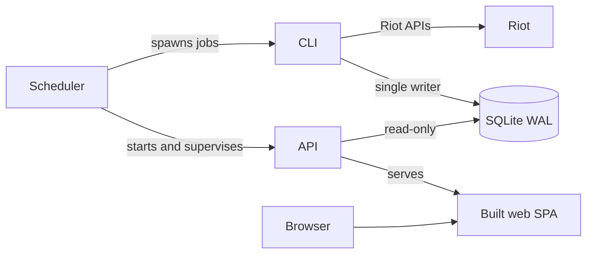

# Riot ID History

Track Riot ID, region, and ban changes for competitive VALORANT leaderboard players — live at [riotid.teyd.dev](https://riotid.teyd.dev).

[](https://github.com/teyd/riotid/actions/workflows/ci.yml)
[](https://nodejs.org)
[](https://pnpm.io)

## What it does

Riot anonymizes most high-rank leaderboard entries, which hides who changed their
name, switched region, or got banned. This service scans the leaderboard, builds a
match-graph fingerprint for anonymous rows, and links a row only when the
fingerprint matches exactly. The result is a public, read-only history with
evidence for every link.

## Quick start

```bash
mise install          # Node 26, pnpm, Worktrunk
mise run install      # dependencies
mise run dev          # API + web dev servers
```

The web app runs at <http://localhost:5173> and the API at
<http://localhost:8787>. An empty development database is auto-seeded; run
`mise run db:seed` for the deterministic synthetic dataset.

Worktrees get isolated dependencies, a database snapshot, credentials, and
hashed ports:

```bash
wt switch --create feature/name
mise run dev
```

## Architecture



| Path                  | Role                                                            |
| --------------------- | --------------------------------------------------------------- |
| `apps/api`            | Read-only Hono API and SPA host                                 |
| `apps/cli`            | Operator CLI for auth, scans, identity, data, and takedowns     |
| `apps/scheduler`      | Production daemon: supervises the API and spawns scheduled jobs |
| `apps/web`            | React 19 + TanStack Router/Query/Virtual SPA                    |
| `packages/db`         | Drizzle schema, migrations, and read/write connection layers    |
| `packages/ingest`     | Leaderboard scan and transactional diff application             |
| `packages/identity`   | Exact-fingerprint anonymous-row resolution                      |
| `packages/config`     | Shared paths and environment contract                           |
| `packages/contracts`  | Versioned API response contracts                                |
| `packages/riot`       | Riot auth, HTTP client, and endpoint adapters                   |
| `packages/test-utils` | Test databases and fake Riot sources                            |

<details>
<summary>Public endpoints</summary>

| Endpoint                     | Purpose                                                    |
| ---------------------------- | ---------------------------------------------------------- |
| `GET /api/v1/index`          | Versioned tuple index; banned and unresolved rows excluded |
| `GET /api/v1/players/:puuid` | Timelines, counters, and identity evidence                 |
| `GET /healthz`               | Database readiness                                         |

Responses are ETagged and support `If-None-Match`. The API never calls Riot.

</details>

## Commands

| Group   | Task                                                                                                       |
| ------- | ---------------------------------------------------------------------------------------------------------- |
| Develop | `mise run dev` · `mise run install` · `mise run check` · `mise run test` · `mise run build`                |
| Perf    | `mise run perf:web` · `mise run perf:compare` · `mise run perf`                                            |
| Data    | `mise run scan` · `mise run stats` · `mise run db:seed` · `mise run db:migrate` · `mise run backup`        |
| Operate | `mise run serve` · `mise run scheduler` · `mise run cli` · `mise run auth:login` · `mise run anon:resolve` |

Run any CLI command through mise, for example
`mise run cli -- player:show <puuid>`. See the [runbook](docs/runbook.md) for
the full operator flow and the in-container forms.

> [!IMPORTANT]
> One process writes to SQLite at a time; the API uses a read-only connection.
> Never scale the service to multiple replicas.
>
> Configuration is defined only in `.env.schema` (Varlock). There is no
> `.env.example`, and secrets are never committed. See
> [configuration](docs/configuration.md).

## Deployment

Production runs on Dokploy from the repository `Dockerfile`, with a named volume
at `/app/data` holding the database, cookie jar, and backups. The scheduler is
the container entrypoint and starts the API as a child process. Deploy with
`mise run deploy`; do not scale replicas or run two writers. Full procedure:
[runbook](docs/runbook.md#deployment-and-scheduler).

## Documentation

- [Architecture](docs/architecture.md) — data flow, boundaries, and invariants
- [Runbook](docs/runbook.md) — exact operator commands and incidents
- [Configuration](docs/configuration.md) — every environment variable
- [Performance report](docs/perf-report.md) — browser timings and limiter
- [Benchmarks](docs/benchmarks.md) — strobe A/B checks for the client path
- [Load report](docs/load-report.md) — API read-path capacity
- [Probe report](docs/probe-report.md) — live Riot endpoint findings

`mise run ci` runs static checks, tests, the web build, and migration
verification. The test suites use temporary databases and fake Riot sources;
they never call Riot.
