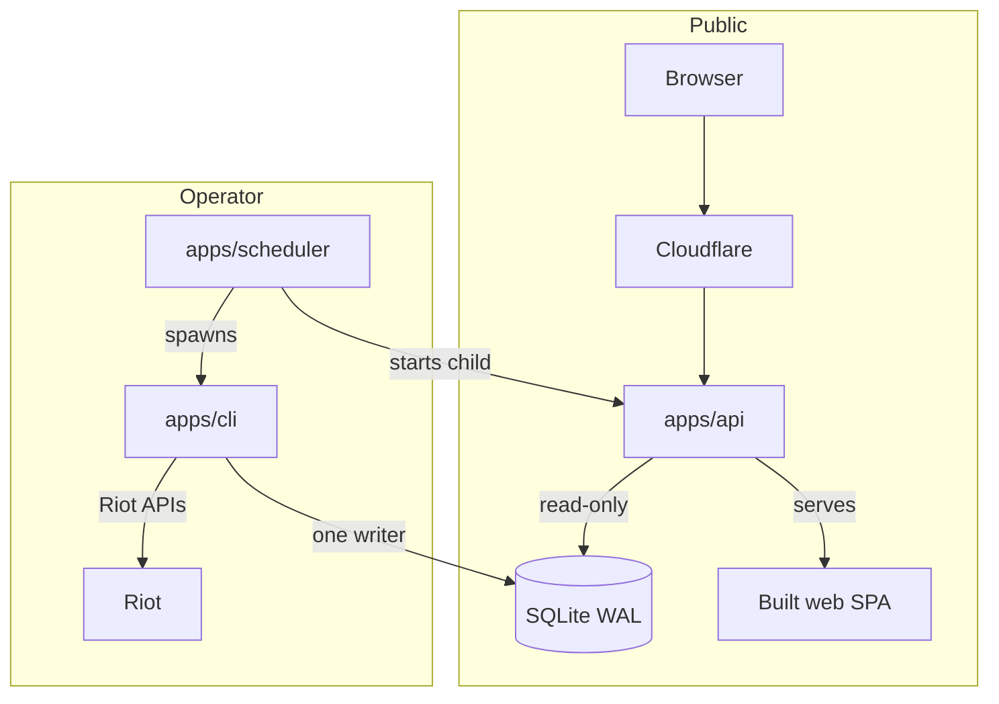

# Architecture

Riot ID History is a single-writer SQLite application split into a read-only API
and an operator CLI. This document describes the boundaries and the invariants
that keep the split safe. For commands see the [runbook](runbook.md) and for
configuration see [configuration](configuration.md).

## Request and data flow

A scan starts in the scheduler (production) or from `mise run scan` (local). The
CLI refreshes auth, walks `na`, `eu`, `ap`, and `kr` page by page until an empty
page, resolves authoritative names in batches, de-duplicates page and
cross-region overlaps, then applies all player, name, region, ban, and anonymous
row diffs in one transaction. A failed region fails the run; partial data is
never applied.

The API only reads. It never calls Riot, never opens a write connection, and
serves the built SPA from the same origin with a fallback for client routes.

## App boundaries

| App or package       | Owns                                                                 |
| -------------------- | -------------------------------------------------------------------- |
| `apps/api`           | HTTP routes, security headers, rate limits, index cache, SPA hosting |
| `apps/cli`           | Auth, scans, identity passes, maintenance, takedowns, seeding        |
| `apps/scheduler`     | API child process, schedules, Riot budget, backup and prune cadence  |
| `apps/web`           | Browser UI; consumes contracts and the public API only               |
| `packages/config`    | Resolved paths and environment contract shared by apps               |
| `packages/contracts` | Effect schemas for index, detail, health, and errors                 |
| `packages/db`        | Schema, migrations, read/write layers, maintenance queries           |
| `packages/ingest`    | Leaderboard crawl, diffs, run evidence                               |
| `packages/identity`  | Anonymous queue, match graph, exact-fingerprint linking              |
| `packages/riot`      | QR/paste auth, token refresh, Riot HTTP adapters                     |

## Read-only API

- Endpoints are `GET /api/v1/index`, `GET /api/v1/search`,
  `GET /api/v1/players/:puuid`, `GET /api/v1/status`, and `GET /healthz`.
  Everything else is a `404` JSON error or the SPA fallback. Status exposes
  only the cookie jar mtime and the staleness threshold; it never reads cookie
  values.
- The index is versioned by `meta.indexVersion`, built in memory, and
  pre-compressed. `index:rebuild` bumps the version; the next request rebuilds.
  It holds the most recently seen `INDEX_PLAYER_LIMIT` public players (50k by
  default) and reports the public total; search covers every visible player.
- Index and detail responses carry `ETag` and honor `If-None-Match` with `304`.
- Limits are 30 requests/min/IP for the index, 120/min/IP for search and
  details. Cloudflare is expected to cache the index (`s-maxage=300`) in front
  of these.
- Search is an FTS5 trigram index (`player_search`) over current and closed
  `player_names` intervals. Triggers keep it in sync; the API only reads it.
  Results are grouped into current and past names, deduplicated per puuid, and
  filtered by the same public/retention predicate as the index. Counts are
  lower bounds because each group returns a capped top set.
- Errors use `{ "error": { "code", "message", "requestId" } }`.
- The index excludes banned players and unresolved anonymous rows, and only
  includes players seen within `INDEX_RETENTION_DAYS`.

## Single writer and SQLite

SQLite runs in WAL mode. Readers see a consistent snapshot while one writer
commits, so the API stays available during a scan. `readDatabase` opens the file
read-only with a five-second busy timeout; `writeDatabase` is used by the CLI
and migrations.

Exactly one process may hold the write connection: the scheduler or a single
operator command. Never run a manual `scan` while the production scheduler is
active, and never scale the service to two replicas. The `runs` table enforces a
unique `running` row, which surfaces accidental concurrency instead of hiding
it.

Backups use SQLite's online backup API while the database is live, then prune
files older than `BACKUP_KEEP_DAYS`. Restore is an offline operation: stop the
scheduler and API first.

## Interval tables

`player_names`, `player_regions`, and `banned_players` are append-only interval
tables. Each row has `started_at`, optional `ended_at`, and nullable
`started_run_id` / `ended_run_id`. A partial unique index allows at most one
open interval (`ended_at IS NULL`) per player.

A change closes the open interval and opens a new one in the same transaction.
Pruning old runs sets provenance to `NULL` through `ON DELETE SET NULL`; it never
deletes history. `player_regions.evidence` records `leaderboard` or `mmr_probe`.

## Ingest run evidence

Every attempt creates a `runs` row with `status` (`running`, `succeeded`,
`failed`), `trigger` (`schedule`, `manual`, `boot`), season, client version,
timestamps, JSON stats, and an error message. Each region gets a `run_regions`
row with pages, players, overlaps, stale or unresolved names, bans, anonymized
counts, and its own error.

On boot, interrupted `running` rows are marked failed with a restart error so the
unique running lock cannot stick. Inspect failures in `runs` and `run_regions`;
a failed run leaves the previous data intact.

## Identity policy

Unresolved `anonymous_rows` are the work queue. A pass:

1. Reuses match candidates from the last `MATCH_CACHE_DAYS` days when present.
2. Seeds nearby leaderboard ranks from `leaderboard_seeds` (`ANON_SEEDS`).
3. Fetches a bounded number of new matches under `ANON_RESOLVE_BUDGET` per day.
4. Links only when rank, ranked rating, wins, and competitive tier match
   exactly. A direct PUUID, when Riot exposes one, is linked with full
   confidence.

Ambiguous candidates are never linked; the row stays `unresolved` and gets a new
`last_tried_at`. A takedown marks rows `ignored` so they are not retried. Every
link stores `match_id`, `method`, `confidence`, and fingerprint evidence in
`identity_links`.

## Scheduler behavior

In production the scheduler is the container entrypoint. It starts the API as a
child process and spawns CLI jobs instead of running Riot work inside the API.

- Scan: catch up on boot when the last success is older than
  `SCAN_INTERVAL_HOURS`, then repeat on that interval.
- Identity: bounded `anon:resolve` batches; pause while a scan runs and resume
  after midnight UTC when the daily Riot budget is spent.
- Auth: refresh the cookie jar before Riot work and while the process runs.
- Maintenance: create a backup shortly after boot and at most once per 24 hours,
  then prune runs older than `RUN_RETENTION_DAYS`.

The scheduler and API share the same volume and environment. Do not run a second
scheduler, and do not run CLI write commands against production while it is
active. `SCHEDULER_DRY_RUN=true` logs jobs instead of spawning them;
`SCHEDULER_JOBS=false` keeps the API supervised with no scheduled work.

## Contracts

`packages/contracts` defines the wire shapes with Effect schemas: the tuple index,
search groups, player detail with timelines and identity evidence, health, and
API errors. The
API and web both type against those shapes, so a change to a field name or tuple
position is a breaking API change. Bump `meta.indexVersion` or coordinate
the change; never silently reshape the index.

## What not to change

- Do not add a write connection or Riot client to `apps/api`.
- Do not add a second scheduler, replica, or parallel writer.
- Do not link identity on approximate or heuristic matches.
- Do not hand-edit migrations; generate and commit them with Drizzle Kit.
- Do not drop run provenance or rewrite interval history during retention.
- Do not add pages or endpoints for removed crawler, stats, or status screens.
- Do not grow the index preview past the 1.5 MB gzip budget without a decision.
  Keep browse cap and search in sync; search must remain complete when the
  preview is capped.
